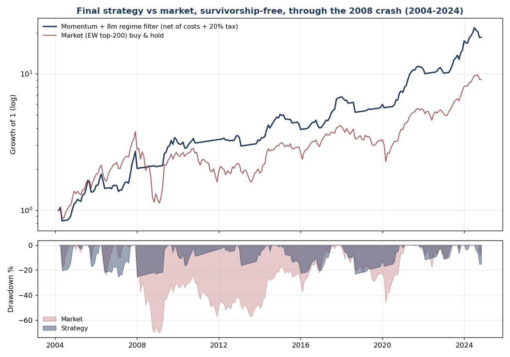

# NSE Momentum Research

A survivorship-free backtest of cross-sectional momentum on Indian equities (NSE), 2004–2024, net of transaction costs and Indian capital-gains tax.

The result is a real but modest edge: the top momentum quintile, held only while the market is above its 8-month moving average, returned **16.2% CAGR with a Sharpe of 0.60 and a −27% maximum drawdown**. Over the same period, the equal-weight market returned 11.2%, with a Sharpe of 0.33 and a −70% drawdown. Most of the work went into trying to break that number. Several earlier "edges" turned out to be selection bias or a bull-market artefact.



## Results

March 2004 to November 2024, monthly data, net of 25 bps per side and holding-period-aware tax (20% short-term, 12.5% long-term).

| Strategy | CAGR | Sharpe | Max drawdown |
|---|---|---|---|
| **Momentum, quarterly rebalance, 8-month SMA regime filter** | **16.2%** | **0.60** | **−27.3%** |
| Momentum, monthly rebalance, 8-month SMA regime filter | 15.1% | 0.54 | −25.5% |
| Momentum, always invested | 12.7% | 0.39 | −74.0% |
| Market (equal-weight top 200), buy and hold | 11.2% | 0.33 | −70.2% |

Reproduced by `bhavcopy_turnover.py` (rebalance comparison) and `bhavcopy_crashcontrol.py` (regime filters).

## Method

| Component | Choice |
|---|---|
| Universe | Each month, the 200 most-traded NSE equities by turnover **in that month**, including stocks later delisted. This removes survivorship bias. |
| Signal | 12-1 momentum: 12-month return, skipping the most recent month |
| Portfolio | Top quintile (about 40 stocks), equal weight |
| Rebalance | Quarterly. It beat monthly on Sharpe with about a third less turnover. |
| Regime filter | Hold stocks only when an equal-weight market index is above its 8-month moving average; otherwise hold cash |
| Costs | 25 bps per side (STT, brokerage, exchange charges, stamp duty, GST, slippage) |
| Tax | Position-level simulation with holding-period-aware capital-gains tax, paid annually |
| Data | NSE month-end bhavcopy files, 2003–2024 |

## What did not survive testing

| Idea | Result |
|---|---|
| Tactical allocation across Indian ETFs | Matched the Nifty and only reduced drawdowns. The apparent edge came from picking gold and Nasdaq with hindsight. |
| Momentum on today's large caps | Looked strong, but the universe was survivorship-biased. On a point-in-time universe the long-short spread became weaker but real. |
| A bull-market-only sample | Showed a Sharpe of about 1.2. Including 2008 roughly halved it. |
| Hidden Markov Model and GARCH-style regime detectors | Lost to a plain moving average (table below) |
| Buffer bands to reduce turnover | Lowered Sharpe and deepened drawdowns |

Regime detectors compared on the same momentum book (`bhavcopy_regime_hmm.py`):

| Regime signal | CAGR | Sharpe | Max drawdown | 2008 drawdown |
|---|---|---|---|---|
| Always invested | 12.7% | 0.39 | −74.0% | −74.0% |
| **Market above 8-month SMA** | **15.1%** | **0.54** | **−25.5%** | **−25.1%** |
| 2-state Gaussian HMM (implemented from scratch) | 10.1% | 0.30 | −59.5% | −58.6% |
| EWMA volatility (GARCH proxy) | 11.9% | 0.39 | −38.0% | −8.2% |

Full write-up of all nine iterations: [docs/research-notes.md](docs/research-notes.md).

## Caveats

- **Backtest, not a track record.** Documented anomalies typically weaken out of sample. Expect live results well below these numbers.
- **Raw prices.** Splits and bonuses are not adjusted. A guard drops stock-months with implausible moves. The remaining noise biases results against momentum.
- **Month-end data.** Intra-month drawdowns are deeper than shown.
- **The universe includes a few ETFs** (for example gold and silver ETFs) that trade like stocks.
- **The tax model is simplified.** It ignores loss carry-forward.

## Repository layout

```
code/
  bhavcopy_factors.py      panel builder: parses old and new (UDiFF) NSE bhavcopy formats
  bhavcopy_strategy.py     position-level simulation with costs and tax
  bhavcopy_turnover.py     rebalance frequency and buffer comparison (headline config)
  bhavcopy_crashcontrol.py regime-filter comparison
  bhavcopy_regime_hmm.py   HMM and EWMA-volatility regime detectors
  live_signal.py           current target portfolio from the latest month
  make_final_chart.py      equity curve and drawdown chart
  fetch_nse_recent.py      downloads recent month-end files from NSE
  refresh_panel.py         appends recent files to the cached panel
  groww_fetch.py           optional: price history via the Groww API (token from env)
  backtest.py, analyze.py, cross_sectional.py, walk_forward.py, core_overlay.py,
  bhavcopy_robust.py, data_fetch.py, fetch_stocks.py, fetch_extra.py
                           earlier iterations (ETF allocation, survivor-biased tests), kept for the record
docs/
  research-notes.md        iteration-by-iteration findings
  images/                  charts
```

## Reproducing

Requires Python 3.10+.

```bash
pip install -r requirements.txt
```

The data is not included in the repo.

1. **Historical month-end files, 2003–2024.** Copy the last trading day of each month from the [girishg4t/nse-bse-bhavcopy](https://github.com/girishg4t/nse-bse-bhavcopy) archive into `code/bhavcopy_nse_monthly/`, named like `31DEC2024.csv`. Set `NSE_BHAVCOPY_DIR` to use another folder.
2. **Months after 2024.** `python3 code/fetch_nse_recent.py` downloads them from NSE into `code/nse_recent/`. NSE blocks many cloud IP ranges, so run this on a home or office connection.
3. **Benchmark series.** `bhavcopy_crashcontrol.py` and `bhavcopy_strategy.py` read `code/data/NIFTYBEES.NS.csv`. `python3 code/data_fetch.py` creates it.

Then:

```bash
cd code
python3 bhavcopy_turnover.py      # headline results (builds and caches the price panel on first run)
python3 bhavcopy_crashcontrol.py  # regime filters
python3 bhavcopy_regime_hmm.py    # SMA vs HMM vs EWMA
python3 make_final_chart.py       # writes docs/images/final_momentum_strategy.png
python3 refresh_panel.py          # optional: add months from code/nse_recent/
```

## Disclaimer

Educational research only. This is not investment advice and not a recommendation to buy or sell any security. All figures are hypothetical backtests.

## License

MIT. See [LICENSE](LICENSE).
