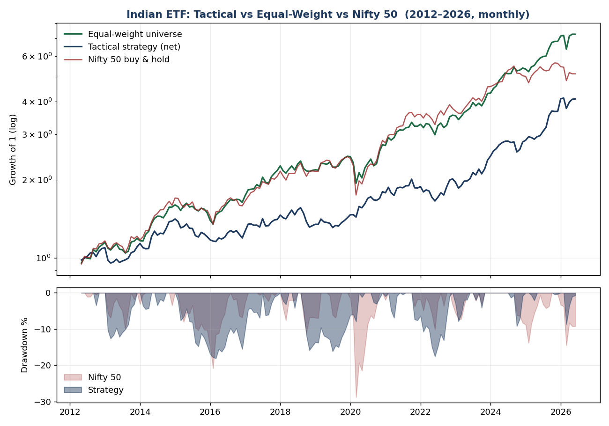

# Research notes

How the strategy in this repo was reached: nine iterations, each trying either to find an edge or to break the current candidate. Most candidates did not survive.

## Iterations

| # | Tested | Result |
|---|---|---|
| 1 | Dual-momentum / tactical allocation across five Indian ETFs (Nifty 50, Nifty Next 50, Nifty Bank, gold, Nasdaq 100) with a trend filter and volatility targeting | 11.2% CAGR vs the Nifty's 12.2% (2012–2026). Volatility fell by about a quarter and the worst drawdown roughly halved, but return did not improve. A risk-reduction result, not alpha. |
| 2 | Broader ETF set, compared against equal-weight and 60/40 | Equal-weight of the same ETFs beat the tactical model. Diversification was doing the work, not timing. |
| 3 | Re-run excluding the best performers (gold, Nasdaq) | The edge fell below the index. The earlier result came from choosing those assets with hindsight. |
| 4 | Cross-sectional momentum on current large caps | Strong-looking returns, but only stocks that survived to today were in the sample. The clean long-short spread was weak. |
| 5 | Point-in-time universe from NSE bhavcopy files (top 200 by turnover each month, including later-delisted names) | Momentum became a real premium: long-short Sharpe rose from 0.20 to 0.70. |
| 6 | Position-level simulation with costs and 20% short-term capital-gains tax | The edge survived full costs and tax. |
| 7 | Market regime filter (hold only when the market is above an 8–10-month average) | Large improvement in a bull-only sample: Sharpe about 1.2, half the drawdown. |
| 8 | History extended back to include 2008 | The 1.2 Sharpe was flattered by the bull market. Through 2008 it settles near 0.55–0.60. Unfiltered momentum fell 74% in 2008. |
| 9 | HMM and GARCH-style regime detectors | Both lost to the simple moving average; the HMM was worst. |

Further tests on the final setup:

- **Rebalance frequency.** Quarterly beat monthly (Sharpe 0.60 vs 0.55) with about a third less turnover.
- **Buffer bands.** Keeping existing holdings until they drop well out of the top quintile reduced turnover but lowered Sharpe and deepened drawdowns.
- **Long-term-gains harvesting.** Momentum turns over too quickly for this to matter: only 3–5% of sales come from positions held over a year.

## The ETF prototype (iteration 1) in more detail

| Metric | Strategy (net) | Nifty 50 buy and hold |
|---|---|---|
| CAGR | 11.2% | 12.2% |
| Volatility | 12.0% | 15.5% |
| Sharpe (rf 5.5%) | 0.50 | 0.48 |
| Max drawdown | −18.0% | −28.8% |

Results were stable across holdings (2–4) and volatility targets (10–16%), with Sharpe between 0.46 and 0.63, but no setting clearly beat the index. At 40 bps per side the Sharpe fell below buy-and-hold, because turnover was about 3.7x a year.

## What held up, and what did not

Held up:
- Cross-sectional momentum is a survivorship-free premium in liquid Indian equities.
- A simple trend filter cuts drawdowns and improves risk-adjusted return.
- The edge survives realistic costs and Indian capital-gains tax.
- It held through 2008 with the filter, and across sub-periods and nearby parameter choices.

Did not hold up:
- ETF tactical allocation as a source of alpha.
- The bull-sample Sharpe of 1.2.
- Extra complexity: HMM, GARCH and combinations all failed to beat a moving average.

## Open work

1. Split and bonus adjustment by chaining daily previous-close prices. This should only strengthen the result.
2. Excluding ETFs from the universe.
3. Paper-trading the quarterly signal to get a genuinely out-of-sample record.
4. Value and quality factors as a diversifying second signal. These need point-in-time fundamentals, which are not freely available for India.
